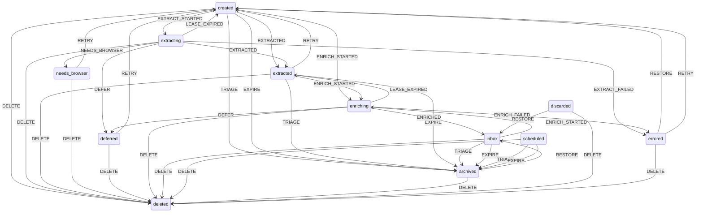

# The linkinbox state machine


Every persisted link sits in exactly one state. The state is stored as the discriminant `links.state` plus the variant payload `links.state_data`, and it is the only source of truth for the status of an item. The legacy `links.status` column is a projection of the state, not an independent field.

## States

| State | Meaning |
| --- | --- |
| `created` | The link is queued for extraction. |
| `extracting` | A runner holds a lease on the link and is extracting. |
| `extracted` | Content is stored, the link waits for enrichment. |
| `needs_browser` | Extraction could not run locally, a browser is needed. |
| `deferred` | Waiting on a rate limit, a backoff or an open breaker. |
| `enriching` | A runner holds a lease on the link and is enriching. |
| `inbox` | Enriched and awaiting triage. |
| `scheduled` | Triaged to be read later. |
| `archived` | Parked, either by the user or because it expired. |
| `discarded` | Explicitly thrown away by the user. |
| `errored` | A stage failed, the link carries the error and the attempts. |
| `deleted` | Terminal tombstone. Nothing leaves this state. |

The processing states `extracting` and `enriching` carry a lease, a `startedAt` timestamp. A `LEASE_EXPIRED` event returns a stranded item to its queue. Every stage run reclaims expired leases before selecting work (`store.reclaimExpiredLeases(cutoff)`), so a killed process never strands a link.

## Events

| Event | Payload |
| --- | --- |
| `EXTRACT_STARTED` | `attempt` |
| `EXTRACTED` | `chars` |
| `NEEDS_BROWSER` | `host` |
| `EXTRACT_FAILED` | `error`, `retryable`, `attempts` |
| `DEFER` | `stage`, `nextAttemptAt`, `attempts`, `reason` |
| `ENRICH_STARTED` | `attempt` |
| `ENRICHED` | none |
| `ENRICH_FAILED` | `error`, `retryable`, `attempts` |
| `TRIAGE` | `action`, `scheduledFor` |
| `EXPIRE` | none |
| `RESTORE` | none |
| `RETRY` | `stage` |
| `LEASE_EXPIRED` | none |
| `DELETE` | none |

## Transition table

| State | Legal events |
| --- | --- |
| `created` | 6 | `EXTRACT_STARTED`, `ENRICH_STARTED`, `TRIAGE`, `EXPIRE`, `EXTRACTED`, `DELETE` |
| `extracting` | 6 | `EXTRACTED`, `NEEDS_BROWSER`, `EXTRACT_FAILED`, `DEFER`, `LEASE_EXPIRED`, `DELETE` |
| `extracted` | 5 | `ENRICH_STARTED`, `RETRY`, `TRIAGE`, `EXPIRE`, `DELETE` |
| `needs_browser` | 2 | `RETRY`, `DELETE` |
| `deferred` | 2 | `RETRY`, `DELETE` |
| `enriching` | 5 | `ENRICHED`, `ENRICH_FAILED`, `DEFER`, `LEASE_EXPIRED`, `DELETE` |
| `inbox` | 4 | `ENRICH_STARTED`, `TRIAGE`, `EXPIRE`, `DELETE` |
| `scheduled` | 3 | `TRIAGE`, `EXPIRE`, `DELETE` |
| `archived` | 2 | `RESTORE`, `DELETE` |
| `discarded` | 2 | `RESTORE`, `DELETE` |
| `errored` | 3 | `RESTORE`, `RETRY`, `DELETE` |
| `deleted` | 0 | (terminal) |

## Diagram



## Reading the state

```ts
import { transition, publicStatus, legacyStatus } from '@linkinbox/core'

const result = transition(state, event)
if (result.ok) {
  console.log(result.state.state)      // the fine grained state
  console.log(publicStatus(result.state))  // the public status projection
} else {
  console.log(result.error.code)      // ILLEGAL_TRANSITION
}
```

The store applies events with an atomic compare-and-set, so two runners can never take the same link:

```ts
const claimed = await store.applyEvent(link.id, { type: 'EXTRACT_STARTED', at: new Date().toISOString() }, 'created')
if (!claimed.ok) {
  // claimed.error.code is STALE_STATE when another runner won the race
}
```

Every applied event is appended to the `link_events` table in the same transaction as the state change, so the history is complete and append-only.

## Deleted is a tombstone

`prune --apply` does not remove the row. It moves the link to `deleted`, purges `extracted_content` and `enrichment`, and keeps `url_hash`. Re-importing the same URL is therefore a no-op and can never resurrect a pruned link. This refines the plan wording, which described prune as a hard delete.

`restore` moves `archived`, `discarded` and `errored` links back to the inbox. It never resurrects a `deleted` link.

## Backwards compatibility

The `status` field of the API is unchanged. It is the `legacyStatus` projection of the state, one of `inbox`, `scheduled`, `archived`, `discarded` or `deleted`. Pipeline states project onto `inbox`, which is what the old code expected from a link that had not been triaged yet. `linkinbox list --state <state>` filters on the fine grained state.

## Seeing everything

The twelve states are only useful if you can see them. There are four surfaces, all backed by the same core functions (`pipelineOverview`, `listPipelineLinks`), so the numbers cannot disagree.

The CLI prints the whole corpus at a glance:

```
linkinbox overview            # state counts + busiest hosts, as tables
linkinbox overview --json     # the same shape as the MCP tool
```

`linkinbox list --state <state>` grows the state, reason and retry columns, so the fine-grained position of each link is visible in the table.

The MCP server exposes two read-only tools: `links.overview` (the state histogram plus the top 50 hosts with their per-state breakdown) and `links.pipeline` (every link with its state, reason and next retry time, filterable by `state`, `host` and `q`).

The web UI has a Pipeline tab in the dock. It shows one row per link with a state badge, the reason the link sits in that state (`login_wall`, `throttled`, `private_404`...), the host, the title and the next retry time. The state filter chips carry live counts, and a host filter and a free-text search narrow the list. Filters live in the URL, so a filtered view is a link you can paste somewhere.

### The API

`GET /api/pipeline` returns the overview:

```json
{
  "byState": { "created": 2, "needs_browser": 1, "inbox": 0, "...": 0 },
  "byHost": [{ "host": "example.com", "total": 3, "byState": { "...": 0 } }]
}
```

`byHost` lists at most 50 hosts, busiest first.

`GET /api/links` gained additive filters and fields: `?state=needs_browser` filters on the FSM state, `?host=example.com` on the host of the url, and every row now carries `state`, `reason`, `host`, `next_attempt_at` and `updated_at` alongside the existing summary fields. Nothing was removed: `?status=inbox` and the rest of the old contract behave exactly as before.

### Badge colours

The UI maps the states onto semantic daisyUI badge colours, never a raw palette, so dark mode keeps working: processing states (`extracting`, `extracted`, `enriching`) are info, blocked states (`needs_browser`, `deferred`) are warning, `errored` is error, the triage states keep their own colours and the parked/dead states (`archived`, `discarded`, `deleted`) are ghost.
